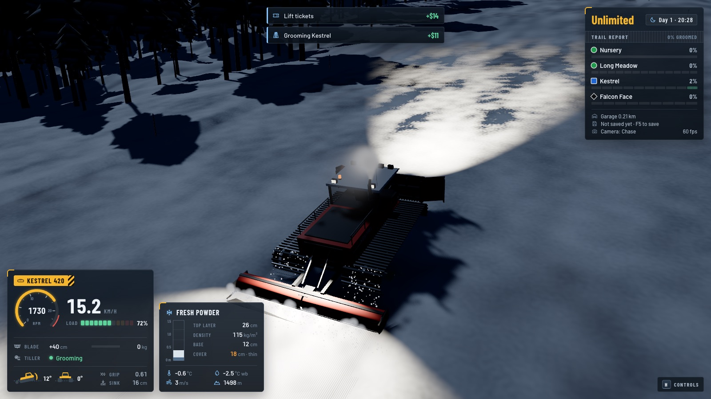
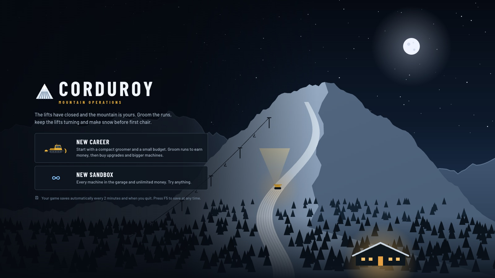
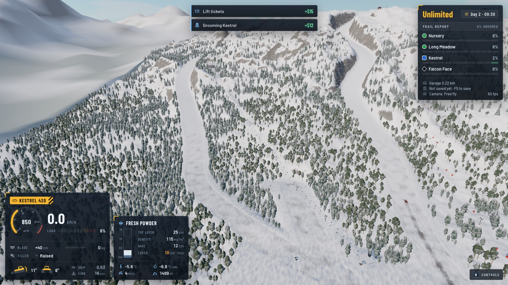
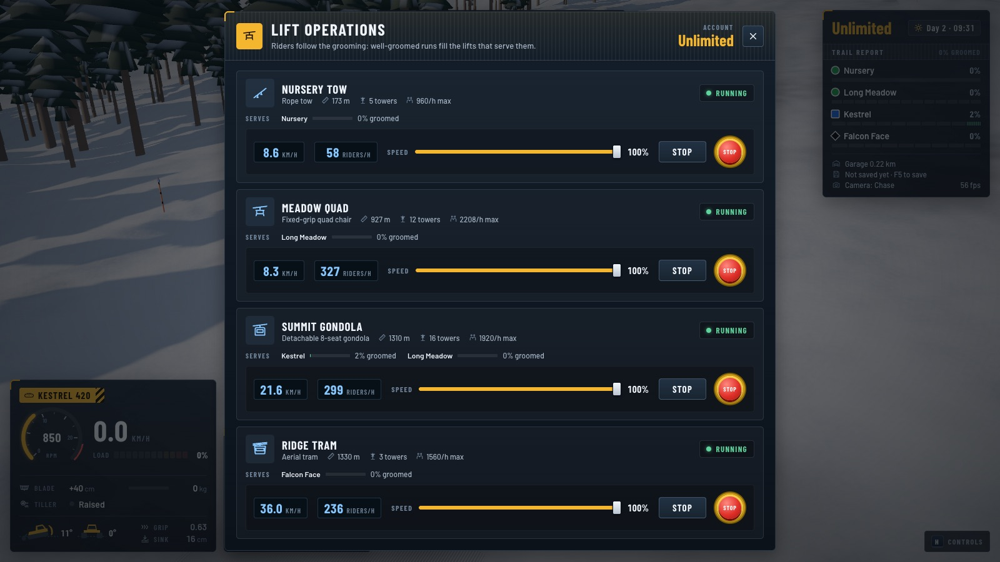

# Corduroy

**Run a ski resort through the night.** Corduroy is a mountain operations simulator: drive tracked groomers over a snowpack that is actually simulated, push snow with the blade and comb it into corduroy with the tiller, winch heavy machines down slopes too steep to climb, run lifts and snowmaking, and get the mountain ready for first chair.

**[Play in your browser](https://auriboyscare.github.io/corduroy/)** (desktop Chrome or Edge with WebGPU; other browsers fall back to WebGL2)



> Corduroy is in active development. What exists today is listed in [DEVELOPMENT_STATUS.md](DEVELOPMENT_STATUS.md); the roadmap is in [docs/MASTER_PLAN.md](docs/MASTER_PLAN.md). Detailed machine and lift models, skiers on the runs, a terrain park editor and multiplayer are being built now.

## What you can do

- **Groom real snow.** The snowpack has a consolidated base and a loose top layer whose depth and density change as you work. The blade cuts, carries and spills snow, which slumps to its angle of repose. The tiller only leaves good corduroy at the right speed and on enough cover. Every operation conserves mass.
- **Drive machines that behave like machines.** Three groomers (Kestrel 260, 420 and 600W), with power-limited hydrostatic drive, sprung track contacts and grip limited by friction and sinkage. The 600W has a winch with constant tension and a cable-end interlock.
- **Upgrade the fleet.** Eight upgrades per machine, from engine remaps and wide-grouser tracks to finisher combs and brighter work lights. Each one changes how the simulated machine performs.
- **Run the lifts.** Rope tow, quad chair, detachable gondola and an aerial tram. Towers are placed for rope clearance, ropes sag, cabins slow through the stations, and an emergency stop sets the chairs swinging.
- **Make snow.** Snow guns work by wet-bulb temperature, which is computed from temperature, humidity and air pressure at altitude, and lay dense snow downwind for you to push out.
- **Work day and night.** The sun and moon follow the clock, and the mountain goes dark at night.
- **Keep your progress.** Saves are atomic and checksummed, with backups. The game autosaves every 2 minutes and saves when you quit.

|                                           |                                                    |
| ----------------------------------------- | -------------------------------------------------- |
|        |  |
|  |                                                    |

## Controls

| Key      | Action                                      |
| -------- | ------------------------------------------- |
| W / S    | Drive forward / reverse                     |
| A / D    | Steer (pivots when stopped)                 |
| R / F    | Blade up / down                             |
| T        | Tiller down and running / up                |
| V        | Cruise control (when fitted)                |
| Y, [ / ] | Winch hook / unhook, tension (Kestrel 600W) |
| G        | Garage: machines and upgrades               |
| L        | Lifts: build and operate                    |
| N        | Snowmaking                                  |
| C        | Camera: chase, cab, free fly                |
| F5       | Save                                        |
| M, H     | Sound, controls card                        |

## Run it yourself

You need [Node.js](https://nodejs.org/) 24 or newer.

```
npm install
npm run dev                    # browser, http://127.0.0.1:5199
npm run build && npm run app   # desktop app (Electron)
```

The desktop app saves to real files with rotating backups. The browser version saves to the browser's private file system.

## How it is built

three.js r187 with the WebGPU renderer and TSL node materials, TypeScript, Vite, Preact for the interface, and Electron for the desktop app. The simulation in `src/sim` is plain TypeScript with no rendering or browser dependencies. Every change to the world goes through a command, so the same code can run headless for tests and, later, for multiplayer hosting. [docs/ARCHITECTURE.md](docs/ARCHITECTURE.md) has the details.

```
npm run check      # lint, typecheck, unit and integration tests, build
npm run test:e2e   # browser and Electron tests
```

Corduroy is developed with the help of [Claude Code](https://claude.com/claude-code). The agents, skills and hooks it uses are in `.claude/`.

## Contributing

Bug reports and ideas are welcome in [Issues](https://github.com/AuriboyScare/corduroy/issues). Please include your browser, operating system and GPU for anything visual or performance-related.

## License

[MIT](LICENSE). The bundled Barlow fonts are under the SIL Open Font License 1.1; third-party assets are listed in [docs/ASSETS.md](docs/ASSETS.md). All machine, lift and resort names are fictional.
